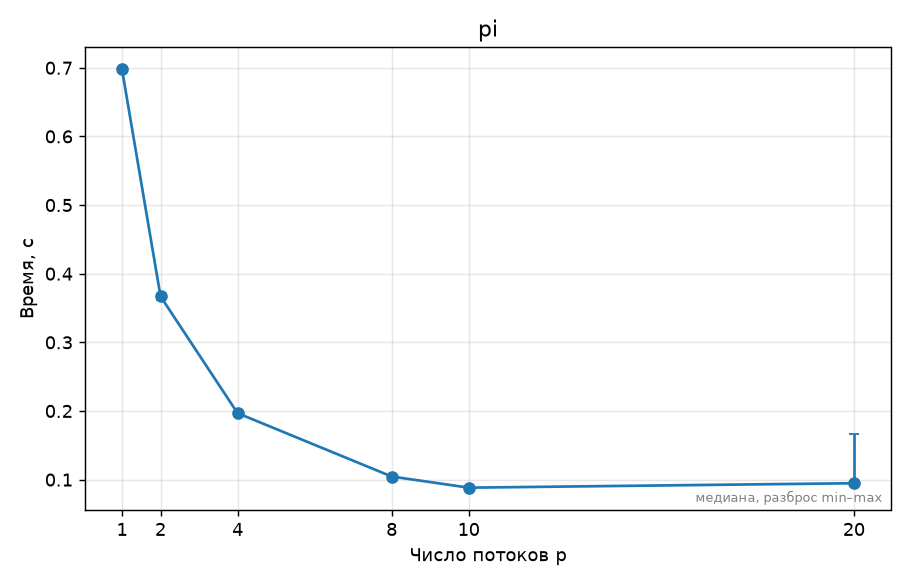
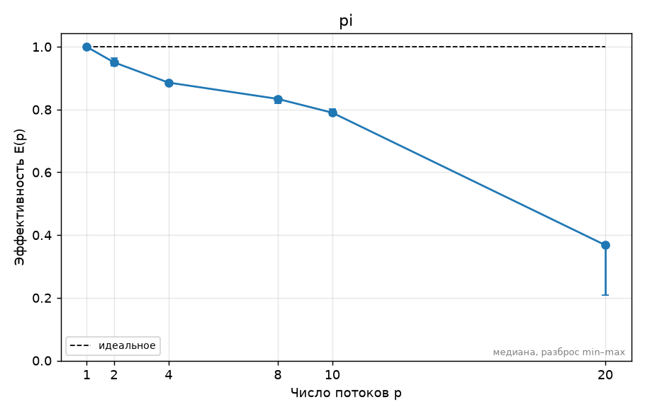

# ДЗ0. Окружение и паспорт стенда — Лукашин Артемий, вариант 8

## 1. Прогноз

Прогноз сформулирован и согласован до запуска замеров; ускорение S(p) = T(1) / T(p).

| Потоков p | Ожидаемое ускорение S(p) |
|---:|---:|
| 2 | около 1,8 |
| 4 | около 3,5 |
| 10 (физические ядра и логические процессоры) | около 5–6 |
| 20 | примерно как на 10 потоках или хуже |

У Apple M4 четыре производительных и шесть энергоэффективных ядер, без SMT. Ожидаю,
что первые потоки преимущественно используют производительные ядра, хотя привязка
не задаётся и это решает планировщик macOS. E-ядра дадут меньший вклад, чем P-ядра.
При 20 потоках новых физических исполнителей не появится: потоки будут делить
10 ядер и добавят расходы на планирование и синхронизацию. Поэтому двукратного
ускорения относительно 10 потоков не ожидаю.

## 2. Стенд

Сведения о машине: [SYSTEM.md](../SYSTEM.md). MacBook Air с Apple M4: 10 физических
и 10 логических ядер, из них 4 P-ядра и 6 E-ядер, SMT нет, ОЗУ 16 ГБ.
ОС macOS 27.0.1 arm64, GCC 16.2.0, `_OPENMP=202111` (5.2), флаги
`-O2 -std=c11 -Wall -Wextra -fopenmp`. L3 системными запросами не определён;
выдавать это за измеренное отсутствие L3 нельзя.

Энергосбережение выключено (`lowpowermode=0`). Перед серией `pmset` сообщил
`AC Power`, но состояние аккумулятора — `discharging` (94%); это неоднозначность
диагностики питания, а не подтверждение стабильной зарядки. IDE и фоновые приложения
принудительно не закрывались. Поэтому результаты характеризуют эту рабочую сессию,
а не полностью изолированный стенд.

## 3. Методика

Вычисляется интеграл от 0 до 1 функции `4/(1+x*x)` методом средних прямоугольников,
N = 800 000 000. Каждый поток накапливает свою локальную сумму и один раз прибавляет
её к общей через `atomic`. Размер выбран после пробного запуска N = 400 000 000,
который занял на одном потоке 0,347803 с: удвоение размера дало около 0,7 с.

Измеряется реальное время `omp_get_wtime()` от начала параллельного участка
до получения pi; запуск процесса и печать не входят. Для каждой из 6 конфигураций
выполнен один прогрев и 5 измерений, итог — медиана. Порядок конфигураций перемешан;
сырые данные и фактические аргументы сохранены в `results/pi.csv` и
`results/pi.meta.json`. Динамическое изменение числа потоков выключено, привязка
к ядрам не задаётся, размещение выбирает macOS.

Из каталога `hw0`:

```bash
make all test
python3 ../tools/bench.py --cmd './build/pi {n}' \
    --threads 1,2,4,8,10,20 --set n=800000000 \
    --env OMP_DYNAMIC=FALSE --env OMP_PROC_BIND=FALSE \
    --repeat 5 --warmup 1 --shuffle --out results/pi.csv
make plots PYTHON=../../.venv-benchmarks/bin/python
```

Последняя команда использует локальное окружение с matplotlib, подготовленное рядом
с репозиторием; при установленном matplotlib достаточно `make plots`.
`make test` проверил pi на 1, 2 и 4 потоках с допуском 1e-9. Во всех 30 измерениях
абсолютная ошибка напечатанного результата относительно pi меньше 1e-9.
ThreadSanitizer локально недоступен из-за отсутствующего libomp для Apple clang;
проверка `make tsan` на 2 и 4 потоках пройдена в GitHub Actions на Ubuntu
с Clang 18 и Archer ([первый запуск CI](https://github.com/LukashinAA/openmp-course/actions/runs/42502501663)).

## 4. Результаты

Дата серии: 8 ноября 2026 года. S(p) = T(1)/T(p), E(p) = S(p)/p.

| Потоков | Медиана T(p), с | Минимум, с | Максимум, с | Ускорение S(p) | Эффективность E(p) |
|---:|---:|---:|---:|---:|---:|
| 1 | 0,697558 | 0,695657 | 0,699153 | 1,000 | 1,000 |
| 2 | 0,366931 | 0,361731 | 0,371062 | 1,901 | 0,951 |
| 4 | 0,196841 | 0,196538 | 0,197340 | 3,544 | 0,886 |
| 8 | 0,104545 | 0,103735 | 0,106207 | 6,672 | 0,834 |
| 10 | 0,088305 | 0,087056 | 0,089378 | 7,899 | 0,790 |
| 20 | 0,094746 | 0,092713 | 0,166630 | 7,362 | 0,368 |



Минимальная медиана времени получена на 10 потоках; 20 потоков её не улучшили.


Ускорение растёт до 10 потоков, но остаётся ниже идеальной линии S(p)=p.
Усы на графиках показывают диапазон min–max пяти измерений.



На 2 потоках эффективность около 95%, на 10 — 79%, на 20 — 37%.
Эффективность рассчитана относительно одного потока той же OpenMP-программы.

## 5. Объяснение расхождений с прогнозом

На 2 потоках ожидалось 1,8 раза, получилось 1,90; на 4 ожидалось 3,5, получилось 3,54.
Прогноз близок к измерению: вычислений на поток много, а атомарное сложение выполняется
один раз на поток, поэтому затраты синхронизации относительно малы.

**Неочевидная точка 1 — 10 потоков.** Вместо ожидаемых 5–6 раз получено 7,90.
Прогноз недооценил совокупный вклад шести E-ядер в эту арифметическую задачу.
Переход с 4 до 10 потоков сокращает время с 0,196841 до 0,088305 с (в 2,23 раза).
Однако трассировки назначения потоков на P/E-ядра нет; влияние планировщика,
частот и фоновой нагрузки этим экспериментом отдельно не разделено.

**Неочевидная точка 2 — 20 потоков.** Ускорение уменьшается с 7,90 до 7,36,
время растёт на 7,3% относительно 10 потоков. Это согласуется с прогнозом:
20 потоков делят 10 ядер без SMT, появляются дополнительные расходы планирования
и ожидания в конце региона. При циклическом делении работы у каждого потока
равное число итераций, но скорость их выполнения может различаться.

На 20 потоках один из пяти запусков занял 0,166630 с вместо медианы 0,094746 с.
Медиана снижает влияние этого выброса. Его конкретная причина не измерялась:
возможны фоновая нагрузка, планирование или изменение частоты, поэтому нельзя
утверждать, что он вызван только перегревом либо только переподпиской.

Скрипт предупредил о разных строках RESULT: `3.141592653589` на одном потоке
и `3.141592653590` на нескольких. Разница порядка 1e-12 укладывается в допуск;
разный порядок суммирования double объясняет расхождение. Тесты и Linux TSan
не выявили ошибки, но совпадение ответа само по себе не доказывает отсутствие гонок.

## 6. Выводы

- На стенде 10 физических ядер, из них 4 P и 6 E, и нет SMT.
- Для этой реализации pi лучшее измеренное число потоков — 10: 0,088305 с,
  ускорение 7,90 раза. Его выбираю базовым для следующих вычислительных задач,
  но для каждой новой задачи проверю масштабирование заново.
- 20 потоков не добавили аппаратных ядер и дали худшую медиану и больший разброс.
- Локальная сумма и одно atomic-сложение на поток позволяют избежать гонки
  без синхронизации на каждой из 800 млн итераций.
- Для более строгого эксперимента стоит повторить серию при однозначно проверенном
  питании от сети и минимальной фоновой нагрузке; текущие CSV сохранены без правок.
