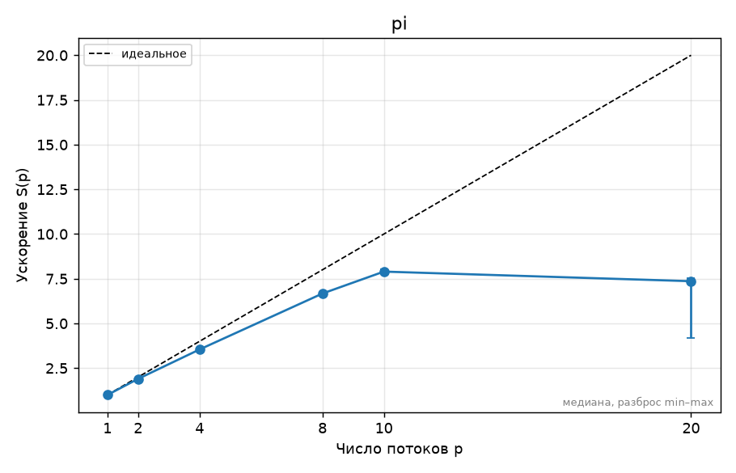

<!-- template:unfilled  ← удалите эту строку, когда отчёт готов к сдаче (иначе CI его не проверяет) -->
# ДЗ0. Окружение и паспорт стенда — Лукашин Артемий, вариант 8

## 1. Прогноз

Прогноз сформулирован и согласован до запуска замеров; ускорение S(p) = T(1) / T(p).

| Потоков p | Ожидаемое ускорение S(p) |
|---:|---:|
| 2 | около 1,8 |
| 4 | около 3,5 |
| 10 (физические ядра и логические процессоры) | около 5–6 |
| 20 | примерно как на 10 потоках или хуже |

У Apple M4 четыре производительных и шесть энергоэффективных ядер, без SMT. Ожидаю,
что первые потоки преимущественно используют производительные ядра, хотя привязка
не задаётся и это решает планировщик macOS. E-ядра дадут меньший вклад, чем P-ядра.
При 20 потоках новых физических исполнителей не появится: потоки будут делить
10 ядер и добавят расходы на планирование и синхронизацию. Поэтому двукратного
ускорения относительно 10 потоков не ожидаю.

## 2. Стенд

<!-- Ссылка на ../SYSTEM.md и то, что важно именно для этого ДЗ: число физических ядер,
     P/E-ядра, объём L3, питание от сети, режим производительности, версия компилятора и флаги. -->

## 3. Методика

<!-- Какие программы и с какими параметрами запускались, сколько повторов, как получено
     итоговое число (медиана), переменные OMP_* (OMP_PROC_BIND, OMP_PLACES, OMP_SCHEDULE…),
     точные команды bench.py/plot.py (или «make bench plots»). Как проверялась корректность. -->

## 4. Результаты

<!-- Таблицы (python3 ../tools/plot.py results/….csv --table) и графики из plots/.
     Каждый график — с подписью: что на нём и какой вывод из него следует.
     Пример вставки:  -->

## 5. Объяснение расхождений с прогнозом

<!-- Для каждого пункта прогноза: подтвердился или нет, почему. Привязывайтесь к конкретным
     точкам: «на 6 потоках ускорение упало с 3,4 до 3,1, потому что …». Минимум две
     «неочевидные» точки графика объяснить обязательно. -->

## 6. Выводы

<!-- 3–5 пунктов: что вы теперь знаете о своей машине и о задаче, что бы сделали дальше. -->
