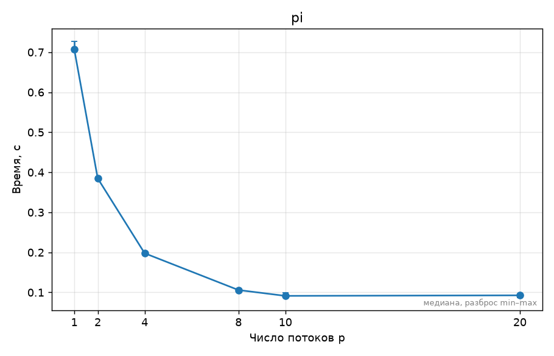
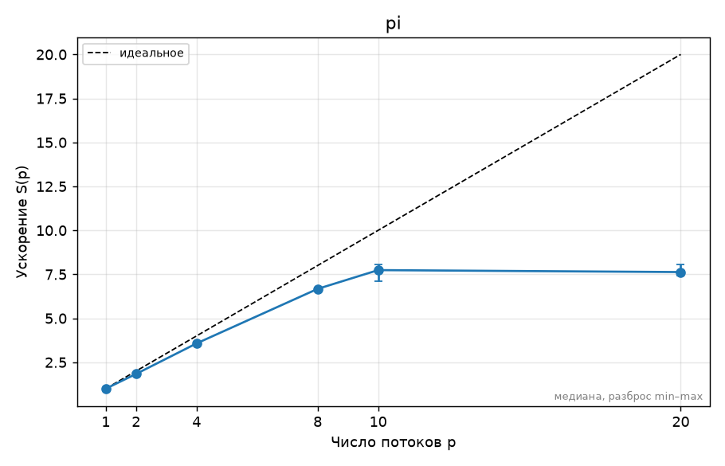
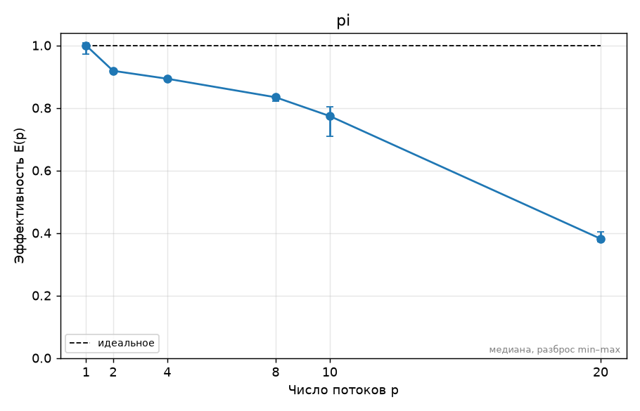

# ДЗ0 — Лукашин Артемий, вариант 8

## 1. Прогноз

Прогноз сохранён до первых замеров отдельным коммитом.
На 2 потоках ожидаю ускорение 1,8 раза, на 4 — 3,5, на 10 — 5–6 раз.
На процессоре 4 P-ядра и 6 E-ядер, поэтому ускорение не обязано быть линейным.
На 20 потоках ожидаю примерно тот же результат, что на 10, или хуже: ядер всего 10.

## 2. Стенд

[Паспорт компьютера](../SYSTEM.md): Apple M4, 10 физических и логических ядер
(4 P + 6 E), 16 ГБ ОЗУ, macOS 27.0.1.
GCC 16.2.0, OpenMP 5.2, флаги `-O2 -std=c11 -Wall -Wextra -fopenmp`.
Новая серия выполнена 23 ноября 2026 года при питании от сети, аккумулятор
заряжается, энергосбережение выключено (`lowpowermode=0`). Фоновая нагрузка
не изолировалась, поэтому небольшие различия времён требуют осторожной интерпретации.

## 3. Методика

Вычисляется pi методом средних прямоугольников, N = 800 000 000.
На каждое число потоков выполнен один прогрев и пять измерений, итог — медиана
времени `omp_get_wtime()`. Запуск процесса и печать не учитываются.
Порядок конфигураций перемешан, `OMP_DYNAMIC=FALSE`, `OMP_PROC_BIND=FALSE`.
`make test` прошёл на 1, 2, 4 потоках, ThreadSanitizer — в Linux CI.

Команда из каталога `hw0`:

```bash
python3 ../tools/bench.py --cmd './build/pi {n}' \
    --threads 1,2,4,8,10,20 --set n=800000000 \
    --env OMP_DYNAMIC=FALSE --env OMP_PROC_BIND=FALSE \
    --repeat 5 --warmup 1 --shuffle --out results/pi.csv
make plots
```

## 4. Результаты

Новая серия заменяет прежние замеры. Исходные данные — [results/pi.csv](results/pi.csv),
оригинальные метаданные этой серии — [results/pi.meta.json](results/pi.meta.json).
S(p) = T(1)/T(p), E(p) = S(p)/p.

| Потоков | Медиана времени, с | Ускорение | Эффективность |
|---:|---:|---:|---:|
| 1 | 0.706904 | 1.000 | 1.000 |
| 2 | 0.384730 | 1.837 | 0.919 |
| 4 | 0.197826 | 3.573 | 0.893 |
| 8 | 0.105945 | 6.672 | 0.834 |
| 10 | 0.091336 | 7.740 | 0.774 |
| 20 | 0.092661 | 7.629 | 0.381 |







## 5. Объяснение расхождений с прогнозом

На 2 и 4 потоках ускорение 1.84 и 3.57 близко к прогнозу 1,8 и 3,5.
На 10 потоках получилось 7.74 вместо 5–6. Предположительно, вклад E-ядер
оказался выше ожидаемого, но размещение потоков по ядрам не отслеживалось.
На 20 потоках медиана выше на 1.5% относительно 10.
Диапазоны времени на 10 и 20 потоках пересекаются
(0.087932–0.099627 и 0.087803–0.095128 с),
поэтому устойчивое преимущество при такой небольшой разнице не установлено.
RESULT отличается примерно на 1e-12 из-за порядка сложения double,
результаты укладываются в допуск 1e-9.

## 6. Выводы

Для этой задачи выбираю 10 потоков, минимальная медиана 0.091336 с.
Увеличение до 20 потоков дополнительного ускорения не дало, эффективность
снизилась с 77.4% до 38.1%.
Для следующих задач число потоков нужно проверять заново.
