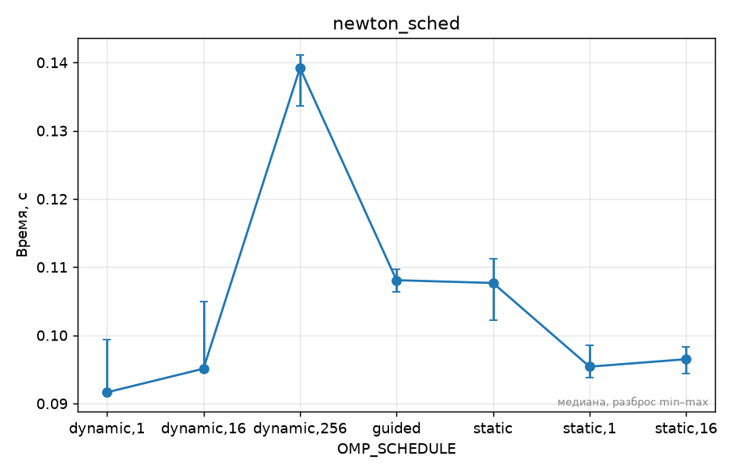
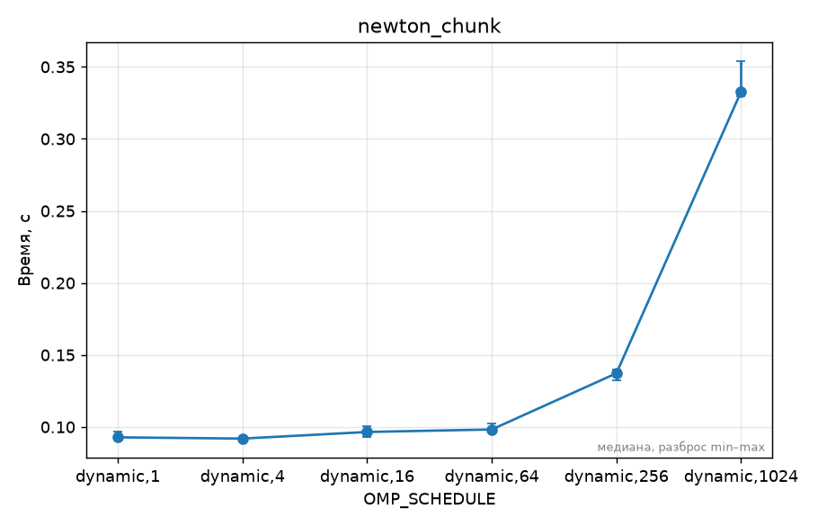
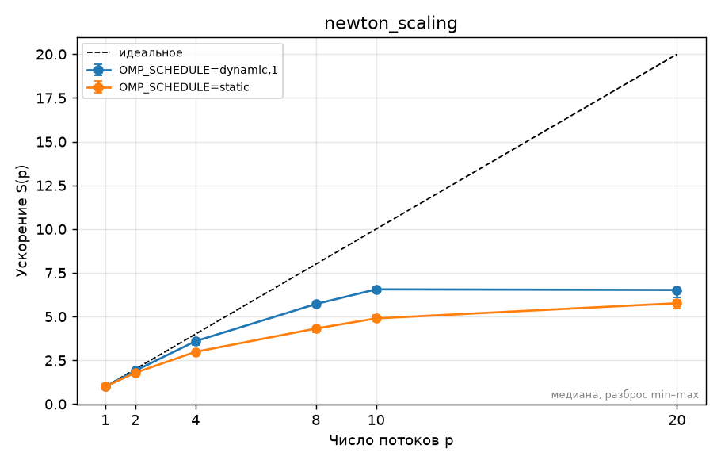
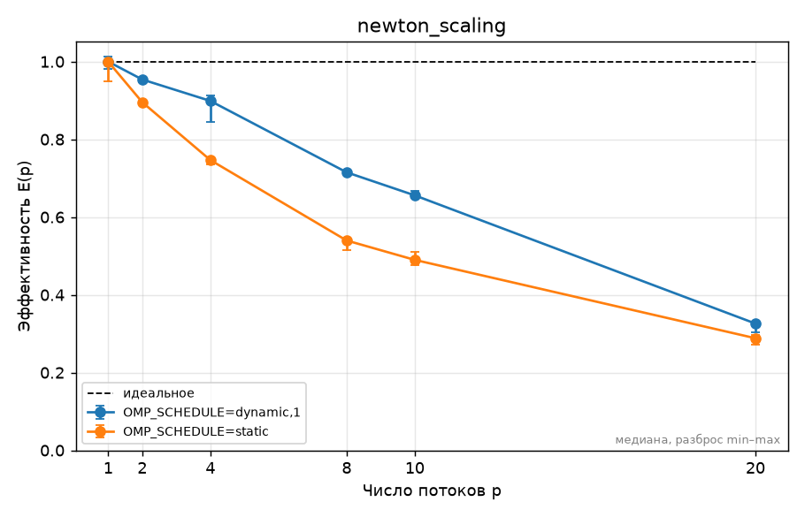
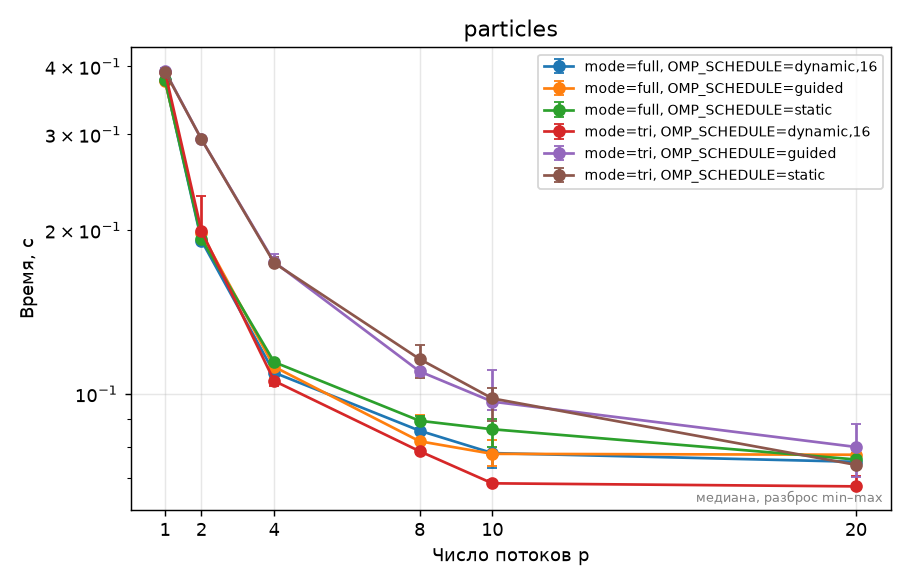
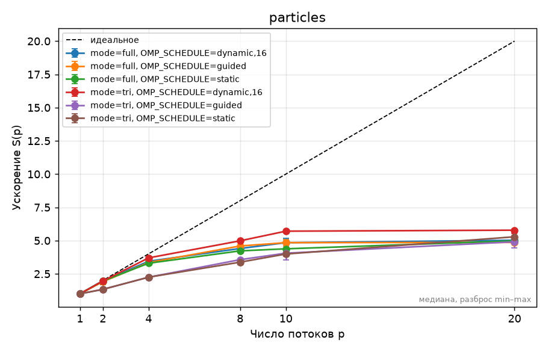

# ДЗ1 — Лукашин Артемий, вариант 8

## Прогноз

Для метода Ньютона на 20 потоках ожидаю лучшим расписание `dynamic,16`.
Стоимость строк различается, поэтому небольшие порции должны уменьшить дисбаланс.
Ожидаю, что `static` будет примерно в 1,5 раза медленнее.

Среди порций `dynamic` ожидаю лучший результат при 16 строках. При порции 1
будут выше расходы на распределение, а крупные порции ухудшат баланс.

На 10 физических ядрах ожидаю ускорение Ньютона примерно в 6 раз относительно
параллельной версии на одном потоке. Повлияют различия P- и E-ядер и расходы OpenMP.

На 20 потоках ожидаю, что `tri` с удачным расписанием будет примерно в 1,5 раза
быстрее `full`. Выигрыш меньше двукратного из-за приватных массивов и их слияния.

Для `forces_full` ожидаю лучшим `static`, поскольку каждая итерация перебирает
одинаковое число частиц. Динамическое распределение добавит расходы.

## Стенд

Apple M4, 4 P-ядра и 6 E-ядер, 16 ГБ ОЗУ, macOS arm64.
GCC 16.2.0, `-O2 -std=c11 -Wall -Wextra -fopenmp`.
[Паспорт компьютера](../SYSTEM.md).
Серия 23 ноября 2026 года выполнена при подключённом адаптере, аккумулятор
заряжается, `lowpowermode=0`. Вывод системы сохранён в `results/power.txt`.
Фоновая нагрузка не изолировалась, привязка потоков к ядрам выключена.

## Методика

Вариант 8. Ньютон — сетка 2000×2000, z⁵−1, окно
[−1,25; 1,25] × [0; 2,50], максимум 200 итераций.
Частицы — 25³ = 15 625, кулоновский потенциал, все 122 062 500 пар.
Последовательные функции заготовки используются как эталон.

Ньютон распределён по строкам. Строк 2000 при максимуме 20 потоков,
поэтому работы внешнего цикла достаточно. `collapse(2)` потребовал бы
подбора порций уже в точках. В `full` поток записывает силу своей частицы,
в `tri` силы объединяются редукцией по трём массивам.

Каждая конфигурация — один прогрев и пять повторов, итог — медиана.
Порядок конфигураций перемешан, `OMP_DYNAMIC=FALSE`, `OMP_PROC_BIND=FALSE`.
Время измеряется `omp_get_wtime()`, включает параллельный регион и редукцию.
Запуск процесса, подготовка координат, выделение массива времён и печать
времён потоков находятся вне замера. Усы показывают min–max пяти повторов.
Ускорение считается относительно однопоточного запуска той же параллельной
версии с тем же расписанием, эффективность равна ускорению, делённому на p.

Сначала выполнены эксперименты расписаний и порций, затем масштабирование
с победителем эксперимента 1, `dynamic,1`. Время отдельных потоков Ньютона
сохранено отдельными диагностическими запусками, оно не входит в медианы.
Для сопоставления работы строк используется `newton_work.c`.

Команды из `hw1`:

```bash
make
make test review-test diagnostics-test
make bench V=8 THREADS=1,2,4,8,10,20 BEST=dynamic,1 REPEAT=5
make diagnostics
make plots
make tables
```

`make test` проверяет пять расписаний на 1, 2, 4 потоках.
Для Ньютона совпадают все номера корней и числа итераций.
Энергия и силы частиц проверяются относительно эталона с допуском 1e-10.
Внешняя версия и диагностика имеют отдельные проверки. ThreadSanitizer
запускается в Linux CI для всех этих программ.

## Результаты

### 1. Расписания Ньютона, 20 потоков

| Расписание | Медиана, с |
|---|---|
| static | 0.107673 |
| static,1 | 0.095401 |
| static,16 | 0.096496 |
| dynamic,1 | 0.091638 |
| dynamic,16 | 0.095107 |
| dynamic,256 | 0.139190 |
| guided | 0.108080 |



Лучший результат у `dynamic,1`, `static` медленнее в 1.17 раза.

### 2. Размер порции dynamic, 20 потоков

| Строк в порции | Медиана, с |
|---|---|
| 1 | 0.092782 |
| 4 | 0.091915 |
| 16 | 0.096502 |
| 64 | 0.098242 |
| 256 | 0.137243 |
| 1024 | 0.332782 |



Минимальная медиана в этой серии у `dynamic,4`.

### 3. Масштабирование Ньютона

| Потоков | static, с | dynamic,1, с | S dynamic,1 | E dynamic,1 |
|---|---|---|---|---|
| 1 | 0.609269 | 0.609591 | 1.00 | 1.000 |
| 2 | 0.340172 | 0.319510 | 1.91 | 0.954 |
| 4 | 0.204003 | 0.169551 | 3.60 | 0.899 |
| 8 | 0.141100 | 0.106547 | 5.72 | 0.715 |
| 10 | 0.124369 | 0.092943 | 6.56 | 0.656 |
| 20 | 0.105667 | 0.093466 | 6.52 | 0.326 |





Время отдельных потоков Ньютона на 20 потоках, секунды:

| Поток | static | dynamic,1 |
|---|---|---|
| 0 | 0.094206 | 0.074571 |
| 1 | 0.097308 | 0.092747 |
| 2 | 0.088472 | 0.092312 |
| 3 | 0.082830 | 0.092831 |
| 4 | 0.078423 | 0.092464 |
| 5 | 0.073616 | 0.092567 |
| 6 | 0.067258 | 0.092652 |
| 7 | 0.073727 | 0.092615 |
| 8 | 0.071858 | 0.092631 |
| 9 | 0.068360 | 0.092572 |
| 10 | 0.061192 | 0.092650 |
| 11 | 0.073814 | 0.082346 |
| 12 | 0.044075 | 0.082203 |
| 13 | 0.077966 | 0.082330 |
| 14 | 0.071396 | 0.082150 |
| 15 | 0.076539 | 0.081792 |
| 16 | 0.068023 | 0.081567 |
| 17 | 0.074589 | 0.078121 |
| 18 | 0.065407 | 0.077073 |
| 19 | 0.067248 | 0.071986 |

### 4. Энергия и силы частиц

| Потоков | full static | full dynamic,16 | full guided | tri static | tri dynamic,16 | tri guided |
|---|---|---|---|---|---|---|
| 1 | 0.377292 | 0.376991 | 0.375994 | 0.391454 | 0.390958 | 0.392275 |
| 2 | 0.192818 | 0.191438 | 0.197332 | 0.293974 | 0.199391 | 0.293965 |
| 4 | 0.114413 | 0.109425 | 0.112164 | 0.174103 | 0.105665 | 0.174782 |
| 8 | 0.089246 | 0.085573 | 0.081833 | 0.115905 | 0.078449 | 0.110013 |
| 10 | 0.086100 | 0.077833 | 0.077583 | 0.098102 | 0.068479 | 0.096779 |
| 20 | 0.075753 | 0.075018 | 0.077287 | 0.074058 | 0.067601 | 0.079877 |

Медианы в секундах.






## Объяснение

1. При `static` потоку 0 достаются первые 100 строк, около y=0.
   По `results/row_work.csv` на них приходится 8,02% всех итераций Ньютона
   вместо равномерных 5%. У полосы 900–999 только 3,82%. На изображении
   трудные точки дают более тёмные границы бассейнов. В диагностическом
   запуске поток 0 работал 0.094206 с,
   самый быстрый поток — 0.044075 с.
   Дополнительно влияет назначение потоков P- и E-ядрам.

2. `static,1` раздаёт соседние строки разным потокам, распределяя тяжёлые
   участки по команде. Его медиана 0.095401 с,
   у `dynamic,1` — 0.091638 с. Улучшение объясняется распределением
   стоимости строк, хотя у циклического `static` выдача порций заранее определена.

3. Малые порции дают много единиц работы и позволяют выравнивать загрузку.
   При порции 1 чаще требуется выдача новой работы, но здесь сама строка
   достаточно дорогая. При 256 строках всего восемь порций на 20 потоков,
   при 1024 — две. Медиана при 1024 равна 0.332782 с.
   Для порций 1, 4 и 16 медианы лежат от 0.091915 до 0.096502 с,
   различие крайних медиан 5.0%. Это сравнительно плоская область.
   Для малых порций нужно учитывать пересечение диапазонов пяти повторов,
   единичный минимум ещё не доказывает устойчивое преимущество.

4. Для треугольного цикла доля первого потока при непрерывном static
   примерно 1−(1−1/p)², при p=20 — 9,75% вместо равномерных 5%.
   Для N=15625 первая порция содержит 782 строки и 11 912 597 пар,
   точная доля 9.759424%. Счётчик диагностики
   подтвердил это во всех пяти повторах, сумма счётчиков равна 122 062 500.
   Медиана рабочего времени потока 0 — 0.048643 с.
   Медиана его доли суммы рабочих времён — 8.36%.
   Пропорциональность времени числу пар неполная: ядра неодинаковы,
   потоки мигрируют, а при 20 потоках есть переподписка. У dynamic,16
   порции выдаются по освобождению потока, поэтому доля потока 0 менялась
   от 0.97% до 7.36%.
   В таблице точное число пар static и медианы рабочих времён,
   измеренные до ожидания остальных потоков.

| Поток | Пар static | Доля static | static, с | dynamic,16, с |
|---|---:|---:|---:|---:|
| 0 | 11912597 | 9.759% | 0.048643 | 0.049815 |
| 1 | 11301073 | 9.258% | 0.056460 | 0.050015 |
| 2 | 10689549 | 8.757% | 0.053564 | 0.057106 |
| 3 | 10078025 | 8.256% | 0.040346 | 0.049054 |
| 4 | 9466501 | 7.755% | 0.043505 | 0.059187 |
| 5 | 8844044 | 7.246% | 0.048621 | 0.059396 |
| 6 | 8234083 | 6.746% | 0.044720 | 0.059193 |
| 7 | 7624122 | 6.246% | 0.044002 | 0.057184 |
| 8 | 7014161 | 5.746% | 0.034772 | 0.053110 |
| 9 | 6404200 | 5.247% | 0.034566 | 0.063202 |
| 10 | 5794239 | 4.747% | 0.033161 | 0.057552 |
| 11 | 5184278 | 4.247% | 0.031352 | 0.057105 |
| 12 | 4574317 | 3.748% | 0.020583 | 0.059295 |
| 13 | 3964356 | 3.248% | 0.024226 | 0.059292 |
| 14 | 3354395 | 2.748% | 0.016273 | 0.059284 |
| 15 | 2744434 | 2.248% | 0.017461 | 0.059373 |
| 16 | 2134473 | 1.749% | 0.007812 | 0.057781 |
| 17 | 1524512 | 1.249% | 0.005383 | 0.056409 |
| 18 | 914551 | 0.749% | 0.007811 | 0.050442 |
| 19 | 304590 | 0.250% | 0.002576 | 0.057099 |

   Диагностика воспроизводит тот же перебор и проверяет силы и энергию
   относительно `forces_seq` в каждом запуске. Счётчики и барьеры добавляют
   расходы, поэтому эти времена служат анализу нагрузки и не подменяют
   основной эксперимент. Исходные данные — `results/particles_diagnostics.csv`.

5. Три приватных массива по 15625 элементов double на 20 потоках
   занимают 3×15625×8×20 = 7 500 000 байт, около 7,15 МиБ.
   Итоговые массивы занимают ещё 375 000 байт. Объединяется порядка
   937500 частичных компонентов, дополнительно нужна их инициализация.
   В отдельной диагностике после завершения работы всех потоков измерен
   интервал слияния и завершения параллельного региона. Он включает
   последний барьер, редукцию и выход из команды. Контрольный регион
   содержит те же барьеры без редукции. Оба отсчёта берёт поток 0.
   Ниже медианы пяти запусков в миллисекундах, последняя колонка — медиана
   попарных разностей интервалов. Это оценка дополнительных расходов,
   точное внутреннее время слияния рантайм отдельно не предоставляет.

| Расписание | Барьер + слияние + выход, мс | Контроль, мс | Разность, мс |
|---|---:|---:|---:|
| static | 0.436 | 0.143 | 0.331 |
| dynamic,16 | 0.474 | 0.143 | 0.326 |

   У full сила накапливается локально и записывается один раз на частицу.
   У tri обновляются оба элемента приватных массивов на каждой паре,
   затем массивы объединяются. Поэтому половина числа пар не гарантирует
   половину времени. Полные времена обеих версий приведены в эксперименте 4.

6. Для обновлений трёх компонентов силы частицы j через `atomic` потребовалось
   бы 3×122062500 синхронизируемых операций. `critical` создаёт общую очередь
   на блокировку. Редукция позволяет выполнять основной перебор с приватными
   силами и объединять результаты после работы.

7. Энергия суммируется в double, поэтому смена порядка сложений меняет
   последние цифры. Проверка сравнивает относительное расхождение с 1e-10.
   У Ньютона сумма целочисленная, во всех сериях `RESULT=49344003`.
   Режим `check` дополнительно сравнивает результат в каждой точке.

8. У Ньютона переход с 10 на 20 потоков изменяет медиану `dynamic,1`
   с 0.092943 до 0.093466 с. Физических ядер 10,
   поэтому удвоение команды не даёт двукратного выигрыша.
   У `tri` расписание `guided` на 4 потоках даёт
   0.174782 с против 0.105665 с
   у `dynamic,16`: большие первые порции сохраняют дисбаланс треугольного цикла.

## Выводы

Для Ньютона по эксперименту 1 выбрано `dynamic,1`. На 10 потоках ускорение
6.56 раза, прогноз был 6. `static` на 20 потоках медленнее
в 1.17 раза вместо ожидаемых 1,5. Прогноз оптимальной порции 16
сравнивается с минимумом `dynamic,4` в эксперименте 2.
Лучший `full` на 20 потоках — `dynamic,16`, 0.075018 с,
лучший `tri` — `dynamic,16`, 0.067601 с.
Предсказанное преимущество `tri` в 1,5 раза не подтвердилось.

Прогноз о достаточности `static` для `full` в целом согласуется с данными:
на 20 потоках `dynamic,16` быстрее по медиане всего на
0.98%. Диапазоны пяти повторов
пересекаются (0.074666–0.077807 с для static,
0.073747–0.075821 с для dynamic,16), поэтому убедительное преимущество
динамической выдачи для равномерного полного перебора не установлено.

Разбор внешней версии и сравнение на одинаковых данных находятся
в [review/README.md](review/README.md).
